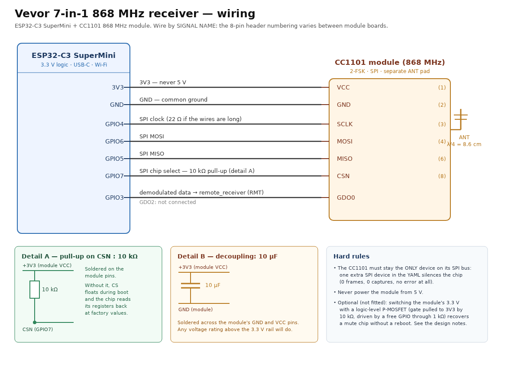

# Vevor 7-in-1 — development document

The **detailed** document: how this firmware is built, verified and tuned, and the tooling around it.
To solder a board and flash it, start at the repository root: [`../README.md`](../README.md).

The firmware **decodes** the 868 MHz frames of a Vevor 7-in-1 weather station (ref. YT60309, Fujian
Youtong family) and publishes outdoor temperature, humidity, wind (speed / gust / direction), rainfall,
UV index, illuminance and the low-battery flag to Home Assistant, while **rejecting** every invalid
frame (header, checksum, TX counter, physical plausibility).

**Status: working and verified** — checksum and TX counter validated, **20.0 s cadence**, plausible
values, **field-by-field agreement between the C++ firmware and an independent Python decoder**,
cross-checked against a second receiver. Evidence and regeneration: [`evidence/README.md`](evidence/README.md).

> Correction: an early validation claimed "60 frames in 10 minutes"; it was **30 measurements delivered
> twice** — a stitching rule wrongly applied to whole bursts (pitfall 5). Fixed, covered by the tests.

---

## Repository layout

The repository root holds **the firmware and its public entry points**: `README.md` (the entry point),
`examples/` (the reference Lovelace cards, `ha-card-fr.yaml` and `ha-card-en.yaml`) and `esphome/`
(**the firmware** — the YAML and the two components), plus `LICENSE`/`.gitignore`.

Everything else lives under **`dev/`** (this folder): how the flash is validated, why each setting is
what it is, and the tooling. Nothing under `esphome/` needs the tooling, and the tooling never touches
the radio. **Paths below are relative to this `dev/` folder.**

| Path | Role |
|---|---|
| `../esphome/vevor-7in1.yaml` | **Production** — the complete ESPHome configuration (firmware) |
| `../esphome/components/vevor_7in1/` | **Production** — the component: `vevor_protocol.h` (pulses → bits → bytes → values, validation gate; pure C++, **testable off-board**) and its glue into `remote_receiver` |
| `../esphome/components/cc1101/` | **Production** — local fork of ESPHome's driver with this board's fixes (`README-LOCAL.md`) |
| `../esphome/secrets.yaml.example` | **Production** — template for `../esphome/secrets.yaml` (never versioned) |
| `docs/` | **Notes** — `wiring.svg` (the root README's drawing), `firmware-design-notes.md` (why each setting is what it is), `bit-jitter-analysis.md` (why single bits go wrong), `forecast-rules.md` (rebuild the console's not-receivable forecast in HA) |
| `tests/`, `tools/`, `evidence/` | **Test** — off-board suite (independent Python encoder + C++ unit tests), the tooling (`tools/README.md`), and the versioned JSON reports backing every claim (`evidence/README.md`) |
| `references/` | **Context** — protocol description + rtl_433 reference source (GPL-2.0-or-later) |

`dev/requirements.txt` lists the tools' Python dependencies. A few **local-only** directories are **not
versioned** (`.gitignore`): `build/` (compile logs, status markers), `logs/`, `state/` and `reviews/`.

---

# PART 1 — PRODUCTION (firmware + Home Assistant integration)

## 1.1 What you need

| Item | Note |
|---|---|
| ESP32-C3 SuperMini | the board this firmware is built for (`board: esp32-c3-devkitm-1`) |
| CC1101 module, **868 MHz** version | 433 MHz modules are the majority in search results and **do not work** here |
| 868 MHz antenna | the supplied helical antenna is enough under ~15 m; a λ/4 wire (8.6 cm) is much better |
| 10 kΩ resistor + 10 µF capacitor | the two components of §1.2 |
| A 5 V supply for the board | the module itself must **never** see 5 V |

## 1.2 Wiring



Full vector version: [`docs/wiring.svg`](docs/wiring.svg). **Wire by signal name, not by header pin
number** — module boards number the 8-pin header differently.

| ESP32-C3 SuperMini | CC1101 | Signal | ESP32-C3 SuperMini | CC1101 | Signal |
|---|---|---|---|---|---|
| 3V3 | VCC | 3.3 V (**never 5 V**) | GPIO5 | MISO | SPI data in |
| GND | GND | ground | GPIO7 | CSN | chip select |
| GPIO4 | SCLK | SPI clock | GPIO3 | GDO0 | data stream, feeds `remote_receiver` |
| GPIO6 | MOSI | SPI data out | — | GDO2 | not connected |

**Why the two components (measured).** The chip intermittently **lost register writes** — `MDMCFG4`
written `0xC8` read back at its factory value `0x8C`: a chip never configured, demodulating nothing,
while its reads stayed reliable, so the fault was in the **link**. With both fitted, the firmware's
write check went from "1 register permanently not taken" to **"0 registers permanently not taken" four
cycles in a row**. The **10 kΩ VCC→CSN** stops CS floating through the boot (at reset the ESP32-C3
GPIOs are high-impedance — Espressif datasheet Table 2-1: IE, no WPU; the YAML option
`cs_pin: mode: {pullup: true}` does **not** replace it, applied only at `setup()`), and the **10 µF
GND→VCC** is decoupling. Also recommended, not fitted: a supply separate from the board's 3V3 pin and
22 Ω in series on SCLK — and nothing on the crystal or the RF path (that detunes).

## 1.3 Entities published to Home Assistant

**The tables live on the home page**: [`../README.md` §4](../README.md), maintained once on purpose — a
copy in two documents drifts. Bind automations to the entity `id` and the published *values*, not to a
display name: HA derives the entity_id from `name:`, so a rename creates **new entities**. Some counters
appear only in the board's log, not as entities (repairs, gate refusals, rain refusals); the periodic
line looks like `captures=143 (+3), frames=47, rejects=1, repaired=1 (0 refused), rain_refused=0, …`.

## 1.4 The console's forecast icon is not receivable

The display console shows one of six icons (Sunny … Snowy) computed from **its own barometer** (Vevor
YT60309 manual, *Weather Forecast*, p. 20); the outdoor sensor transmits no pressure field.

> **The station's own forecast icon cannot be read off the air with this hardware.** An earlier
> iteration estimated the six categories *inside the firmware*; it was **removed at the owner's
> request** — when the station cannot provide the information, the receiver must not invent it.

Any forecast is left to Home Assistant, using [`docs/forecast-rules.md`](docs/forecast-rules.md). One
manual rule stays usable: the **ice alert** (p. 20, snowflake below 1 °C) is a plain threshold.

## 1.5 Install and flash

```bash
# 1. Secrets (once) — never versioned; nothing else to configure (no location, clock or time zone)
cp ../esphome/secrets.yaml.example ../esphome/secrets.yaml && $EDITOR ../esphome/secrets.yaml
tools/build.sh                    # 2. build: BUILD OK / BUILD FAIL to build/last_status.txt
tools/flash.sh /dev/ttyACM0       # 3. flash over USB first (the C3's USB-Serial-JTAG)
tools/flash.sh <board-ip>         #    …then OTA by IP
# 4. Capture and evaluate the board's logs (native API, port 6053 — no browser needed)
.venv/bin/python tools/capture_logs.py --host <board-ip> --seconds 120 --out logs/capture.log
tools/eval_frames.py logs/capture.log --json logs/report.json
```

Both components are read from this public repository, so your own config needs only this block:

```yaml
external_components:
  - source: github://WizardPC/esphome-vevor-7-in-1@main
    refresh: 0s            # re-check the branch on every compile
    components: [vevor_7in1, cc1101]
```

`@main` follows the current version; pin a tag or commit to fix it (then `refresh: 0s` is not needed).
ESPHome answers `External components are overriding built-in components: cc1101` — expected, keep both
names. Building **inside a clone** must use the local sources instead: that is what `tools/build.sh` and
`tools/flash.sh` do (`-s vevor_components components`); without it a build fetches `@main` and ignores
your working tree.

## 1.6 Home Assistant notes

* The board uses the **native API** with encryption; HA discovers it on the LAN. If mDNS does not cross
  your router, the `wifi: use_address:` value in the YAML is what OTA and log capture target.
* `api: reboot_timeout: 0s` is deliberate: the board must not reboot when no client is connected,
  otherwise a log-capture session gets cut in the middle.
* The board **reboots itself on purpose** after prolonged frame silence: on this hardware one boot in
  two brings up a chip absent from the SPI bus, and a reboot is the only measured remedy — pitfall 7.
* Diagnose with `Rejected frames` (decoding) vs `RMT captures` (nothing reaching the chip) before
  touching anything. `Illuminance` is in lux (up to 327 670 lx); `UV index` is unitless, 0…16.

---

# PART 2 — TESTS, VALIDATION AND TOOLING

## 2.1 Off-board test suite (no board needed)

```bash
tools/run_tests.sh
```

Steps: self-check of the independent Python encoder (it must reproduce the rtl_433 reference frame
**byte for byte**) → generation of the test frames and pulse scenarios → compilation of the C++ test
with the compiler bundled in `.venv-dev` (zig) → execution → the entity/dashboard consistency check
(`check_ha_card.py`, both example cards) → the card-template check against Home Assistant
(`check_ha_templates.py`, skipped when HA is unreachable). **The run prints its own total** —
`N checks, 0 failure(s)` — the single source of truth for the count, which this document does not
repeat. It covers the happy path, inverted polarity, truncated captures, jitter, timing bias, inter-burst
gaps, stitching (a *complete* burst is never stitched), the plausibility gate and its reasons, the
period-selection sweep and the fragment policy. It is not a tautology: the C++ decoder and the Python
encoder are **written separately from the same specification**, and the suite carries **external
anchors** (the rtl_433 frame, hand-computed ×10 lux values) so an error present in *both* fails.

## 2.2 Independent decoder and window reports

`tools/eval_frames.py` re-implements the decoding in Python and **compares frame by frame** with the
values the firmware published. A `PASS` verdict requires simultaneously: ≥ `--min-valid` valid frames
(10 by default); values inside the physical ranges **and** a coherent lux/UV pair; a TX-counter advance
consistent with the elapsed time (~1.95 tick/s); a ~20 s cadence; and **field-by-field agreement with
the C++ firmware** on every frame. A report with an anomaly can no longer conclude `PASS`.
`tools/summarize_window.py` adds window-level analysis (cadence, gaps, rejections, per-10-min emission
counts, value ranges) and **reuses its report's verdict** — a summary cannot contradict its own report.

The `evidence/` folder holds the versioned JSON reports backing the project's claims: a **validated**
one-hour window (180 frames, `PASS`) and a **faulty** one (181 frames, `FAIL`, three refusal reasons,
kept on purpose — the defect the plausibility gate and the stitching rule were written for). Each keeps
the raw 21-byte frames, so the claims stay checkable after a `git clone` (the full `logs/` are not).

## 2.3 Field tools

| Tool | Role |
|---|---|
| `build.sh`, `flash.sh`, `run_tests.sh` | compile (`BUILD OK`/`BUILD FAIL` marker); flash over OTA; off-board suite |
| `capture_logs.py`, `eval_frames.py`, `summarize_window.py` | capture logs (native API, 6053); independent decoder; window summary from a report |
| `read_state.py`, `press_button.py`, `dump_pulses.py`, `decoder_dump.py` | read entities; press a firmware button (`--list-buttons`); fetch and decode the "Dump pulses" durations off-board |
| `scan_freq.py`, `verify_radio_config.py` | live frequency scan; check the applied radio config |
| `board_watch.py`, `temperature_spike_watch.py` | 6-hourly watches (counter deltas, gate activity, restart reason) |
| `check_ha_card.py`, `check_ha_templates.py` | entity/dashboard consistency offline; card templates against HA |

`tools/README.md` inventories the remaining probes, scans and watches (current flow vs. historical
diagnostics) and the contracts every tool obeys — no secret written or printed, no success claimed
without a measurement, no window concluded on without checking the chip's state — and the method rules
hold throughout: a decoding claim cites a raw log line, never trust a script through a pipe, one
hypothesis at a time on the radio side, never delete a log trace.

---

## Known pitfalls of this build (measured, not supposed)

* **`loop()` is interrupt-driven: an early `return` in `setup()` that skips `attach_interrupt` makes the
  board permanently deaf, with no other symptom.** The component calls `disable_loop()` at the top of
  `loop()`; only the GDO0 edge interrupt wakes it again. Without the interrupt the chip still receives
  (FIFO filled, GDO0 high, register writes verified) and **no frame, ever**, arrives; it is now attached
  **before any early return**, and `reset()` re-attaches it.
* **1 — The CC1101 must remain the ONLY device on its SPI bus.** A second SPI device in the YAML — even
  with a **free, unwired** CS pin — silences the chip: 0 captures, 0 frames, no error (0 frames / 60 s
  with it, 5 frames / 60 s without, against a reference firmware). **Instrumenting the chip from the
  same firmware costs the reception** — measure from outside (log capture) instead.
* **2 — The station transmits CONTINUOUSLY**, one burst every 20 s, day and night. A "0 frame" is
  therefore **never** silence from the station: it is the receiver — but it proves nothing unless a
  reference receiver decoded in the **same window**, because one boot in two brings up a mute chip
  (pitfall 7). The station's supposed "silent phases" were in fact **mute boards**.
* **3 — No `gdo0_pin` in the `cc1101` block** when `remote_receiver` consumes the same pin: the
  component schedules a deferred `pin_mode(INPUT)` that breaks the RMT channel.
* **4 — `ota: encryption: {}`** makes the API key serve as the OTA key. To take over a board running
  third-party firmware you need a fallback YAML **without** `encryption:` under `ota:`
  (`../esphome/flash-plain.yaml`) plus the prebuilt binary via `--file`.
* **5 — Only stitch FRAGMENTS of a burst, never a whole burst.** The C3's RMT sometimes delivers a
  burst in two pieces (96 + 82 pulses), rejoined by merging same-sign pulses at the seam; applying that
  to **every** capture re-reads the PREVIOUS burst (the faulty version published **60 frames for 30
  measurements**). Rule: decode the capture ALONE first, stitch only if too short (`MAX_FRAGMENT_TIMINGS`).
* **6 — A well-formed frame is not a JUST frame.** Over one hour, out of 181 valid frames (header +
  checksum + counter all good), **2 were wrong**: a one-bit shift doubles every value byte, reporting
  178.2 mm instead of 59.2 and a direction of 779°, and such a checksum can still pass. Hence the
  **plausibility gate** (direction > 359°, humidity > 100 %, wind > 180 km/h, UV > 16).
* **7 — One boot in two can bring up the chip absent from the SPI bus**, signalled by nothing but a
  silent `captures=0` (over 6 cycles: mute / healthy / mute / healthy / mute / healthy): it reads
  `Chip ID: 0xFFFF`, the hot re-arm does **not** recover it, **the reboot does**. Hence the supervision:
  re-initialisation attempts while no **new frame** is published, then an **automatic reboot**.

## USB access from an LXC container (Proxmox)

To flash over USB from a container, pass the host's serial port into the LXC (`/etc/pve/lxc/<id>.conf`,
then restart): the ESP32-C3 appears as **`/dev/ttyACM0`** (USB-Serial-JTAG, major **166**) — **not**
`/dev/ttyUSB0` (major 188), which may exist without being usable (`c---------`).

```
lxc.mount.entry: /dev/ttyACM0 dev/ttyACM0 none bind,optional,create=file
lxc.cgroup2.devices.allow: c 166:* rwm
```

Then check `ls -l /dev/ttyACM0` (`crw-rw----`, reachable) and membership of the `dialout` group. Without
this everything but the first flash still works (use web.esphome.io or the ESPHome add-on).

## Licence and attributions

* **GPL-3.0-or-later** (see `../LICENSE`; each source file carries the SPDX header). The frame
  format comes from **rtl_433** (`src/devices/vevor_7in1.c`, GPL-2.0-or-later); a reference copy is
  kept in `references/vevor_7in1.c`. The licence floor is the local `cc1101` fork: ESPHome publishes
  its C++ code under the GPLv3 (`esphome/components/cc1101/README-LOCAL.md`).
* The **`WizardPC/esphome-vevor-7in1`** project (MIT, <https://github.com/WizardPC/esphome-vevor-7in1>,
  same protocol, asynchronous architecture) served as a comparison point — measured radio parameters
  and protocol pitfalls — never as a code base.
* The **Vevor YT60309 owner's manual** is the source for two facts only: the console computes its six
  forecast icons from its own barometer, and the ice alert trips below 1 °C.
